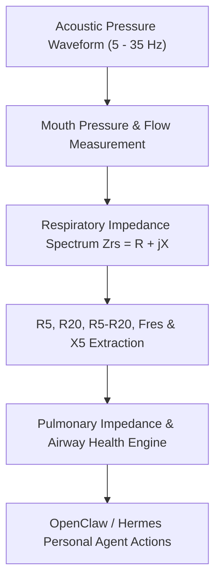

# Forced Oscillation Technique (FOT / IOS) Skill

[](LICENSE)
[](https://www.python.org/)
[](requirements.txt)
[](mcp_server.py)
[](SKILL.md)

Zero-dependency sovereign personal agent skill for non-invasive evaluation of Forced Oscillation Technique (FOT / IOS) airway resistance, peripheral impedance, and lung mechanics.



## Features
- **Deterministic Math**: Pure Python standard library implementation with zero external dependencies.
- **Effort-Independent Respiratory Mechanics**: Validated IOS formulas assessing resistance without forced exhalation maneuvers.
- **Peripheral Small-Airway Obstruction Stratification**: Early detection of bronchiolar narrowing and particulate irritation.
- **Model Context Protocol (MCP)**: Native JSON-RPC tool integration for LLMs and autonomous agents.

## Quickstart

```python
from client import PulmonaryOscillometryClient

client = PulmonaryOscillometryClient()
result = client.evaluate_respiratory_impedance(
    resistance_5hz_cmh2o_l_s=3.15,
    resistance_20hz_cmh2o_l_s=2.70
)
print("Peripheral Resistance R5-R20:", result["peripheral_frequency_dependence_r5_r20"])
print("Classification:", result["classification"])
```

## License
Apache-2.0
